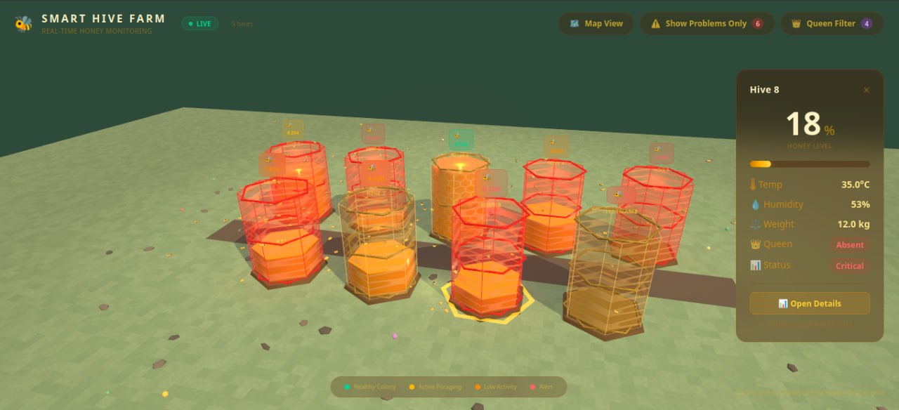
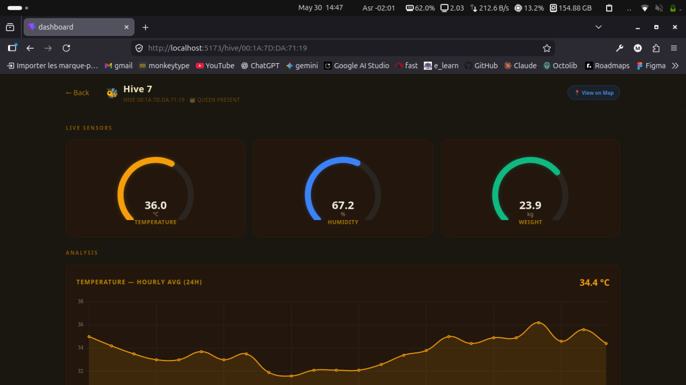
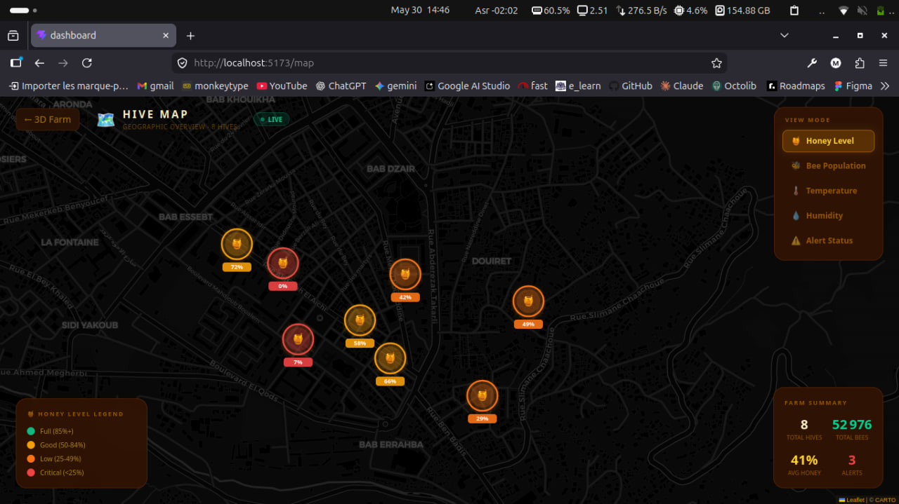
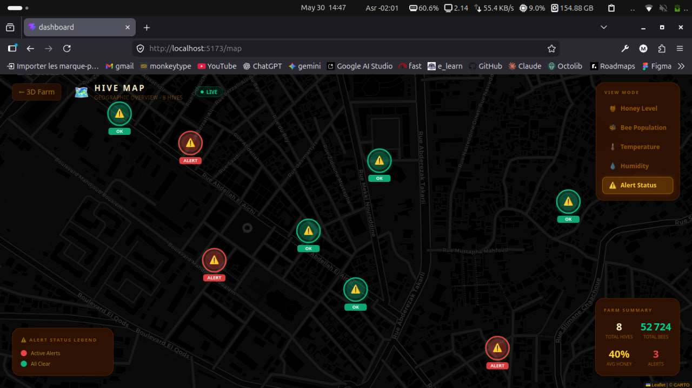

# 🐝 Oran Data Hack - Smart Hive Monitoring

<div align="center">
  
</div>

<p align="center">
  
  
  
  
</p>

This project presents a smart beehive monitoring system designed to track hive health in real time. It combines simulated IoT telemetry, MQTT-based messaging, and interactive dashboards to help beekeepers monitor temperature, humidity, weight, honey fill, and GPS activity across multiple hives.

## 🌟 Project idea

The system models a modern precision-beekeeping solution where each hive sends live telemetry to the cloud and dashboards. The goal is to detect abnormal conditions early, reduce colony losses, and provide a clear operational picture from both a farm and geographic perspective.

## 🧩 Main components

- [smart-hive/server/main.py](smart-hive/server/main.py): Python simulator that generates synthetic hive telemetry and publishes it through the MQTT pipeline.
- [smart-hive/dashboard/index.html](smart-hive/dashboard/index.html): Standalone browser dashboard that connects to the public MQTT broker via WebSocket.
- [dashboard/src/App.jsx](dashboard/src/App.jsx): React dashboard with a 3D farm view and map-based hive tracking.

## 🔄 Conceptual data flow

Sensors or simulator → MQTT broker → web dashboards

## 📊 Project highlights

- Real-time hive monitoring for key environmental metrics
- Multi-hive farm overview and geographic map view
- Early warnings for overheating, excessive moisture, and swarm risk
- End-to-end data path from telemetry generation to live visualization

## 🖼️ Figures

<table>
  <tr>
    <td align="center"></td>
    <td align="center"></td>
  </tr>
  <tr>
    <td align="center"></td>
    <td align="center"></td>
  </tr>
</table>

## 🏗️ Architecture overview

```text
┌──────────────┐     MQTT      ┌──────────────────┐     MQTT/WS     ┌─────────────┐
│  Simulator   │──────────────▶│  HiveMQ Broker    │◀───────────────▶│  Dashboard  │
│  (Python)    │  publish      │  (Public Cloud)   │   subscribe     │  (Browser)  │
└──────────────┘               └──────────────────┘                 └─────────────┘
```

## 🚀 Setup references

- [smart-hive/README.md](smart-hive/README.md) for the Python pipeline and standalone dashboard
- [dashboard/README.md](dashboard/README.md) for the React app setup and usage

## 🐝 About the system

This repository demonstrates how Internet of Things data can be collected, transmitted, and displayed in a meaningful way for agricultural monitoring. It combines simulation, cloud messaging, and web-based visualization to create a complete smart-farming concept centered on hive health and decision support.
